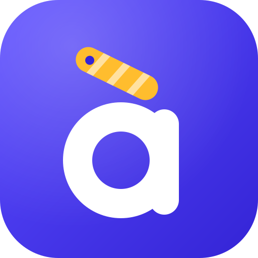

<p></p>

# Itàn

*Ìtàn is Yoruba for story. Every film starts with one.*

Free visual boards for notes, to-do lists, links, pictures, videos and plans, in the spirit of Milanote. Boards can hold other boards, as many and as deep as you like.

**Live app:** https://kingenonso.github.io/Itan/ (after GitHub Pages is switched on, see below)

## Get Itàn

| Device | How |
|---|---|
| **iPhone / iPad** | Open the web app in Safari → **Get the app** → Share → **Add to Home Screen** |
| **Android** | Open the web app in Chrome → **Get the app** → **Install** |
| **Windows** | Download the installer from [Releases](https://github.com/kingenonso/Itan/releases/latest), or install from Edge or Chrome |
| **Mac** | Download the `.dmg` from [Releases](https://github.com/kingenonso/Itan/releases/latest), or in Safari choose File → Add to Dock |
| **Linux** | `.AppImage` or `.deb` from [Releases](https://github.com/kingenonso/Itan/releases/latest) |

The desktop installers aren't signed yet, so Windows and Mac ask you to confirm the first time (Windows: **More info → Run anyway**; Mac: right-click → **Open**). App store listings are explained in [STORES.md](STORES.md).

Each device and each way of opening Itàn keeps its own boards. To move boards between them, use **Share → Download everything** on one and **Open a board file** on the other.

## Why it's free and close to unlimited

Like a Word document, everything you make in Itàn is saved **on your own device**, inside the browser's storage. Nothing is uploaded to a server, so:

- there's no storage bill for whoever runs the app
- the only limit for users is their device's free space, and videos can be any size
- it keeps working without internet after the first visit, and can be installed like an app (browser menu → Install)

Each device and browser keeps its own copy. To move or share a board, use **Share → Download** to get a `.board` file. Pictures and videos travel inside the file. The other person opens it with **Share → Open a board file**.

## Features

**Safety**
- **Backups** (shield button): free cloud backup a couple of minutes after changes, encrypted on your device with a recovery code only you hold (the server can't read it). Restore on any device with the code. Pictures and voice notes included; videos optional. Also a one-file backup to download and open anywhere.

**Look and feel**
- **Studio and Daylight**: a neutral grading-suite grey by default (easy on the eyes on a night shoot, and it doesn't tint your pictures), or a bright Daylight look. Switch with the sun/moon button.
- **Prep · Shoot · Post**: the film's tools are grouped by stage, under a slate header with the film's title.
- **Welcome and tour**: new users can explore a sample film, The Last Danfo, already written, broken down, storyboarded, scheduled and budgeted, with a short guided tour. The ? button in the film workspace replays the tour.

**What makes it different**
- **Boards are portals.** Each board card shows a live miniature of what's inside, and opening one zooms you through it.
- **Narrated walkthroughs.** Record your voice while you move around a board and click cards. Playback moves the screen and highlights each card in time with your voice.
- **Present mode** (P). A slideshow that glides from card to card in reading order.
- **Voice to text.** Optional, on the device: voice notes, board explanations and walkthroughs get written out and become searchable. Needs a one-time download of about 80 MB, then works offline.

**Work together live**
- **Comments and @mentions**: select a card and choose Comment. Type @ to mention someone; they get a notice the next time they open Itàn.
- **Approval links**: in a video's Review, get a link for a client or producer. They watch in their browser, leave notes at exact moments, and approve the cut or ask for changes. Their notes land in your review notes.
- **Casting**: list roles (or add them from the script), write who they are and paste the sides (or take the character's lines from the script), and share one casting link. Actors choose a role and send their details, a headshot and a self-tape (a video up to 60 MB, or a link) from their phone. Review by role, rate and take notes, shortlist and call back, compare self-tapes side by side, and cast: the actor goes onto the People tab.
- **Locations**: one page per place you're shooting, made from your script's scene headings. Pin it on the map (search the address, or stand there and tap "I'm here"), and see where the sun rises, sets and sits at any time on your shoot date, with the direction shadows fall. Keep the contact, fee, permit, power, parking, noise, toilets, nearest hospital and access notes; send the fee to the budget; keep scouting photos with the direction you were facing. Each day's call sheet gets a "Getting there" block with a QR code for directions.
- **Director's Viewfinder**: your phone camera shows what your real camera and lens will see. Choose the camera (full frame, Super 35, Blackmagic, ARRI and more) and the lens (14–135mm or any focal length), frame inside 16:9, 2.39, 1.85, 4:3 or vertical lines, and see the sun's path for the shoot date drawn over the picture (point at the real sun and tap Align for accuracy). Snap a frame straight onto a shot card as its storyboard frame, or into a location's scouting photos with the lens, direction and time saved.
- **Weather**: an hour-by-hour forecast for each shoot day at its location, from crew call to wrap. Itàn reads the day's scenes and warns about what matters: rain on exterior scenes, thunderstorms near lights and power, wind for sound and frames, heat for cast and crew, and cloud that changes the light. When rain is likely on an outdoor day it suggests an indoor day to swap with, in one tap. Alerts for the next few days appear when you open Itàn (and as phone notifications if you allow them), and go onto the call sheet. More than 16 days out, it shows what that date has usually been like over the past five years.
- **Crisis alerts on everyone's phone**: turn on alerts once on each phone ("Alert me on this phone"). Itàn's free server checks the forecast for the next three shoot days every 3 hours, even when the app is closed, and sends a notification for a thunderstorm, flooding rain, dangerous wind, extreme heat, or rain on an outdoor day. When a crisis is close, Itàn opens a crisis screen with the nearest hospital, the emergency number and the meeting point, and one tap to alert the crew. "Alert the crew" sends any message to every phone following the film, and on WhatsApp to people without the app. (On iPhone, add Itàn to the Home Screen first.)
- **Departments**: the first tab in Prep and Shoot. It has a desk for every department, grouped the way a film crew is organised, and every desk is built from the script, schedule, locations and the other desks.
  - *Director's overview*: the next shoot day (call, wrap, scenes, cast, weather), how ready every department is, and everything that needs the director, live as the team works.
  - *1st AD*: the running order for each day from page counts, set-ups, company moves and lunch, with a warning for days over 12 hours. Makeup calls, meals and the call sheet follow it.
  - *Camera and DIT*: a card log with two backups and a check for every card, and the storage the shoot needs for your recording format.
  - *Grip*: the camera support each day needs, from the moves on the Shot cards, and stands and sandbags (more when it's windy).
  - *Art department*: every set from the scene headings, its look, what to bring or build, references, and whether it's ready before the camera arrives.
  - *Wardrobe*: costume changes per character, which scenes they're worn in, fittings, made from the Continuity notes in one tap.
  - *Hair and makeup*: who sits in the chair when, worked backwards from each actor's first scene, put on the call sheet in one tap.
  - *Stunts and safety*: the emergency plan (hospital, emergency number, meeting point, medic) and a risk check for every scene with fire, weapons, fights, heights, water, vehicles, crowds or children.
  - *Transport*: vehicles, drivers, seats and pick-ups. *Catering*: people to feed and meal times each day, diets, and the cost into the budget.
  - *Edit and VFX*: VFX shots and their status, and the editor's notes with the circled takes. *Music*: the cue sheet and licences. *Clearances*: releases, agreements, licences and insurance, with the signed copies.
  - *Lighting and power* (gaffer, DP): lights per scene with job, gel and diffusion, a top-view lighting plan you draw, and the power for each shoot day: the biggest load, amps, the generator size to hire and rough fuel.
  - *Continuity* (script supervisor): each character's look in every scene, with photos, beside how they looked in the scene before it in the story, with warnings when you shoot out of order. Exports a continuity book.
  - *Props*: every prop from the script with status, source, cost, who has it and the return date, a pull list for each shoot day, alerts for props not ready, and costs sent to the budget.
  - *Sound*: a mic plan per character, how many lavs each day needs, the noise to expect (location notes, wind, rain, the generator), and room tone, effects and wild lines to record before you move.
  - *Colour* (colorist, DP, DIT): looks with reference frames and their main colours pulled out, the scenes each look covers, camera profile, white balance, grading space and deliverables. Exports a look book.
  - *Producer*: budget, days, pages and people at a glance, and everything every department has flagged, worst first, each one a tap from where to fix it.
  - *BTS*: moments worth capturing each day (first slate, effects, vehicle rigs, night exteriors, the wrap), interviews, a post plan, and a place for BTS photos and clips.
- **Crew sign-up links**: on the People tab, share a link where crew enter their job, phone and the shoot days they're free. Add them to the crew in one tap.
- **Live**: tap Live on any board to share it and everything inside it. You get an edit link and a view link to send on WhatsApp. Everyone sees changes as they happen, sees who's online and which board they're on, and pictures and videos (up to 95 MB each) are shared too. Each person keeps a full copy, so it works offline and catches up later. It runs free on Cloudflare (the `server/` folder, deployed by the Live server GitHub Action using the `CLOUDFLARE_API_TOKEN` and `CLOUDFLARE_ACCOUNT_ID` secrets).

**Made for planning films**
- **Set Mode** (On set tab): the shoot day's control room on every phone. NOW and NEXT shots in big type, what the next setup needs from the breakdown, a clock showing whether the day is ahead or behind and when you'll wrap at this pace, warnings before the light goes for outside shots (with one tap to move them up), suggestions of what to drop to wrap on time, one-tap takes that move everyone on, and a wrap report that carries unshot scenes to the next day. Producers can follow with a view link.
- **Film production template**: one tap builds pre-production, production and post-production boards for a whole film.
- **Script writing**: a screenplay editor that formats as you type (Enter moves to the next element, Tab changes it). Save as a proper screenplay PDF or a Fountain file, and send it straight to the breakdown.
- **Lined script (the Living Script)**: every shot is a coloured line down the side of the script over the lines it covers, solid once it has a circled take. Lines no shot covers, and dialogue only seen in a wide shot, are flagged before the shoot. Tap any line to see its shots and sketches, takes, edit notes, and notes or voice notes left on it. Heat map and PDF.
- **Script breakdown**: paste or open a script (plain text, Fountain, Final Draft .fdx or PDF). Itàn splits it into scenes, finds the characters, and lets you tag props, wardrobe, hair and makeup, vehicles, effects and extras by selecting words.
- **Smart breakdown**: Suggest tags finds props, wardrobe, makeup, vehicles, effects, extras and missing cast in every scene, offline. Check with Gemini adds Google’s AI using your own free key (kept on your device). You choose which suggestions to keep.
- **Shooting schedule**: colour-coded scene strips (inside or outside, day or night) that you drag into shoot days, with page counts and screen time per day. Group by location puts scenes in the same place together.
- **Call sheets**: made for each shoot day from the schedule, breakdown and cast list. Add the address, parking, weather and nearest hospital, then send it to WhatsApp or save it as a picture or PDF.
- **Shot cards**: numbered shots (1A, 1B…) with size, lens, movement, angle, a storyboard frame and a status. The Shots tab lists every shot in the film and saves as a picture or PDF.
- **Shot list from the script**: Itàn suggests coverage for each scene the way directors plan it: a master or establishing wide, following shots for movement, dialogue coverage that fits who's talking (singles, over-the-shoulders, close-ups), reaction close-ups on emotional moments, and inserts of key props. Gemini (your own free key) can suggest instead. Chosen shots become Shot cards in a column per scene, with their lines already marked on the lined script.
- **Sketch storyboards**: draw a shot's frame with a finger, stylus or mouse: pen, marker, arrows for movement, boxes for framing, and thirds, centre and widescreen guides.
- **Animatic**: play the frames in shot order with your own timing and a recorded voice-over, and save it as a video.
- **Sun and weather**: call sheets fill in sunrise, sunset, golden hour and the forecast for the location and date (forecasts from Open-Meteo, free).
- **Camera tools**: storage needed for the shoot by recording format, a lens field-of-view guide for any sensor, and shutter and ND filter settings.
- **Take log**: log takes from a phone on set (circled, OK or no good, clip, notes, camera and sound rolls). It makes camera and sound reports, and exports a metadata file DaVinci Resolve reads so circled takes are marked in the edit.
- **Budget**: departments and line items (quantity × rate × days), planned against actual, contingency, any currency (naira by default). Add cast and crew fills in a line per person. Save the summary as a PDF.
- **Reports**: Day Out of Days, one-line schedule, location report and needs by day, each saved as a PDF or picture.
- **Post-production tracker**: edit, sound, music, colour, effects and subtitles tasks with owners and due dates, cut versions, and a delivery checklist.
- **Festival tracker**: deadlines, fees, links and results, with the next deadline up front.
- **Review notes**: open any video card in Review, pause anywhere and pin a note to that moment. Export the notes as markers for DaVinci Resolve (EDL) or copy them as text.

**Every day**
- **Today** (T). Every unticked checklist item from every board, grouped by due date, with reminders while Itàn is open or installed.
- **Share to WhatsApp, Telegram or email** through the phone's share sheet. When installed, Itàn also appears in other apps' share menus, and shared items land on an Inbox board.
- **History.** Slide back through earlier versions of a board and restore one.

**Trust and polish**
- **PIN lock** for a board and everything inside it. This keeps casual eyes out on a shared phone, but it is not encryption, and a forgotten PIN can't be recovered.
- **Tidy** lines cards up neatly. Dragging snaps to nearby cards (hold Alt to place freely).
- **Templates**: wedding or event, business plan, content calendar, study timetable, moving house, trip, weekly planner, moodboard.
- **Save as picture or PDF** for people who don't use Itàn.

**The basics**
- Notes, headings, checklists with due dates, links, pictures, videos, voice notes, colour swatches, columns, lines between cards
- Boards inside boards, a floating dock of tools, and a ring of tools wherever you double-click
- Search across every board (Ctrl+K), undo and redo, works offline, installs like an app

## Project layout

| File | What it does |
|---|---|
| `index.html` | The page layout |
| `css/app.css` | The look and the motion |
| `js/config.js` | App name and which storage to use (`local` today) |
| `js/storage-local.js` | Saves boards and media on the user's device (IndexedDB) |
| `js/app.js` | The board app itself |
| `js/features/live.js`, `server/` | Live teamwork: the app side and the free Cloudflare server |
| `js/features/film-*.js`, `css/film.css` | Film workspace: script, breakdown, smart tags, schedule, call sheets, shots, budget, reports, people, review notes |
| `js/features/` | Today, sharing, walkthroughs and Present, voice to text, history, PIN lock, tidy, templates, export |
| `sw.js` | Offline support |
| `manifest.json`, `icons/` | Install as an app |
| `src-tauri/` | Desktop app for Windows, Mac and Linux (Tauri) |
| `.github/workflows/desktop.yml` | Builds the desktop installers on GitHub |

## Run it on your computer

Any static web server works, for example:

```bash
cd Itan
python3 -m http.server 8000
```

Then open http://localhost:8000

## Put it online with GitHub Pages (free)

1. On GitHub, open the repository → **Settings** → **Pages**
2. Under **Build and deployment**, set **Source** to *Deploy from a branch*
3. Choose branch **main** and folder **/ (root)** → **Save**
4. After a minute the app is live at `https://kingenonso.github.io/Itan/`

## Switching to cloud storage later

The app talks to storage only through `js/storage-local.js`. A cloud version adds a second file with the same functions (`loadAll`, `put`, `del`, `onChange`, `putMedia`, `getMedia`, `mediaUrl`, `listMedia`, `deleteMedia`, `usage`) that saves to a server instead, and `js/config.js` switches `storage` to `"cloud"`. That version adds sign-in, live collaboration, invites and permissions. Its cost scales with how much people store. For example, Cloudflare R2 gives 10 GB free each month, then charges per GB stored, with no download fees.

## Rename the app

Change the name in `js/config.js`, the `<title>` in `index.html`, and `name`/`short_name` in `manifest.json`.
